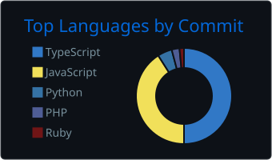

# Angel Alvarez

**Software Engineer · Backend & Cloud · TypeScript, Node.js, Python, Design Patterns, Software Architecture, AWS**

I design and ship cloud-native backends, real-time systems and third-party integrations for SaaS products. 5+ years across customer-engagement SaaS, fintech, government systems and aerospace software. Remote, based in Honduras.

## English

- 🔭 **Now:** Software Engineer at **Escala** (customer-engagement SaaS), owning features end to end across backend, frontend, mobile and AWS infrastructure.
- 🚀 **Building:** an AI-powered appointment-scheduling SaaS for businesses in Honduras, taking it from 0 to 1.
- 🤖 **AI-assisted engineering:** I designed the multi-agent workflows on Claude Code that my team uses for support-ticket triage and feature planning (Jira, Zoho Desk, CloudWatch, DynamoDB, Playwright, MCP).
- ⚡ **Impact:** bulk import cut from 24 hours to 30 minutes for 50,000 records (-96%); real-time notifications for thousands of concurrent users; WhatsApp, Facebook and Instagram integrations for enterprise clients.
- 🧩 **Strengths:** event-driven and serverless design on AWS (Lambda, SQS, SNS, DynamoDB), third-party API integrations (auth, rate limits, retries, data normalization), caching with Redis, code review and engineering standards.
- 💬 **Ask me about:** serverless and event-driven architectures, integrating Meta and messaging APIs, AI agent workflows for engineering teams.
- 🎓 B.S. in Computer Science Engineering (UNAH). Earlier work: fintech platforms (Applaudo), government systems (Datum), flight software for Honduras' first satellite (Proyecto Morazán) and penetration-testing training (SISAP).

## Español

- 🔭 **Actualmente:** Software Engineer en **Escala** (SaaS de engagement con clientes), a cargo de features de punta a punta en backend, frontend, móvil e infraestructura en AWS.
- 🚀 **Construyendo:** un SaaS de agendamiento de citas con IA para negocios en Honduras, llevándolo de 0 a 1.
- 🤖 **Ingeniería asistida por IA:** diseñé los flujos multiagente en Claude Code que mi equipo usa para atender tickets de soporte y planificar features (Jira, Zoho Desk, CloudWatch, DynamoDB, Playwright, MCP).
- ⚡ **Impacto:** importación masiva reducida de 24 horas a 30 minutos para 50.000 registros (-96%); notificaciones en tiempo real para miles de usuarios concurrentes; integraciones de WhatsApp, Facebook e Instagram para clientes enterprise.
- 🧩 **Fortalezas:** diseño serverless y orientado a eventos en AWS (Lambda, SQS, SNS, DynamoDB), integraciones con APIs de terceros (autenticación, rate limits, reintentos, normalización de datos), caché con Redis, code review y estándares de ingeniería.
- 💬 **Pregúntame sobre:** arquitecturas serverless y orientadas a eventos, integración de APIs de Meta y mensajería, flujos de agentes de IA para equipos de ingeniería.
- 🎓 Ingeniería en Ciencias de la Computación (UNAH). Antes: plataformas fintech (Applaudo), sistemas gubernamentales (Datum), software de vuelo para el primer satélite de Honduras (Proyecto Morazán) y formación en pruebas de penetración (SISAP).

## 🛠️ Tech stack

  

